# ProActive Assistant

**A real-time meeting companion that speaks up only when it's worth it.**

Turn it on during a meeting and it transcribes the conversation live with **Muse Voice Transcribe**. **Muse Spark** watches the transcript and, without being asked, surfaces short insight cards: it explains jargon and acronyms, flags claims that look wrong, suggests sharp questions, and captures decisions and action items. When the meeting ends you get a summary, a list of decisions and an action-item checklist, all exportable as Markdown.

Built for the Meta Global AI Developer Hackathon.

## Features

- **Live transcript** with partial (gray) and final lines, timestamps and speaker labels (Muse diarization).
- **Proactive insights**: definition, background, fact check, question to ask, action item, decision, related idea. You can pin, dismiss, copy, ask for "tell me more", or click the quote to jump to that moment in the transcript.
- **Calm by design**: debounced triggers, a minimum interval between calls, de-duplication, confidence filtering and at most one card per type per call.
- **Audio sources**: microphone (with device picker), a browser tab (Meet/Zoom web/Teams web in Chrome/Edge), mic + tab, or the built-in demo meeting.
- **End-of-meeting notes**: summary, decisions and action items with owner and due date, plus pinned insights and the full transcript. Export as `.md` or copy.
- **Resilient**: the browser-to-server and server-to-Muse links both reconnect automatically. Audio captured while disconnected is buffered and replayed. A half-spoken line is kept when a connection drops. The transcript survives page reloads (stored in the browser only).
- **Demo mode**: a 2.5-minute scripted meeting (4 voices). It can run through the live Muse pipeline, or fully **offline** with a pre-recorded transcript and insights for bad conference Wi-Fi.
- **Privacy**: API keys stay on the server; there is no server-side storage; a visible REC indicator and a consent reminder are shown.
- Light and dark mode, responsive layout (panels stack on mobile).

## Architecture

```mermaid
flowchart LR
  subgraph Browser["apps/web · Next.js"]
    SRC[Mic / Tab / Demo audio] --> AW[AudioWorklet<br/>24 kHz PCM16, 100 ms]
    AW --> WSC[WsClient<br/>auto-reconnect + 30 s buffer]
    WSC --> ST[(Zustand store<br/>persisted locally)]
    ST --> UI[Transcript · Insights · Summary]
  end
  subgraph Server["apps/server · Node.js + ws"]
    GW[HTTP + WS gateway<br/>Origin check + HMAC token] --> SES[Session]
    SES --> STT[STTProvider<br/>Muse / Mock]
    STT --> CTX[ContextManager<br/>rolling window + running summary + shown list]
    CTX --> TRG[TriggerEngine<br/>words / pause / min interval / abort]
    TRG --> LLM[LLMProvider<br/>Muse / Mock]
    LLM --> PP[postProcess<br/>Zod · confidence · dedupe · anchor]
  end
  WSC <-->|binary audio ↑ · JSON events ↓| GW
  STT <-->|wss · realtime ASR| MVT[(Muse Voice Transcribe)]
  LLM -->|chat/completions · json_schema| MS[(Muse Spark 1.3)]
  UI -->|/api/explain · /api/summary| GW
```



```
proass/
├── packages/shared/        # Zod schemas, WS protocol, trigger presets, demo script + player
├── apps/server/            # Node/TS backend (deploy separately: Railway, Fly.io, Render, Docker)
│   └── src/{stt,llm,context,trigger}/   # adapters + pipeline
├── apps/web/               # Next.js frontend (deploy on Vercel or any static/Node host)
│   └── public/worklets/pcm-processor.js # 24 kHz resampler
└── scripts/                # dev runner, demo audio generator, end-to-end smoke test
```

### How the Muse APIs are used

| | Muse Voice Transcribe (`muse-voice-transcribe-1.0`) | Muse Spark 1.3 (`muse-spark-1.3-contributor`) |
|---|---|---|
| Endpoint | `wss://api.meta.ai/v1/asr/realtime` | `POST https://api.meta.ai/v1/chat/completions` |
| Auth | `authorization.accessToken` in the first handshake frame | `Authorization: Bearer` header |
| Usage | `DIARIZATION` mode, `CUMULATIVE` partials, raw PCM16 24 kHz binary frames, `keywords` for jargon, `languageBias` from the language picker | Suggestions use `response_format: json_schema` (strict), `reasoning_effort: minimal`. Running summary, "tell me more" and the end-of-meeting summary (strict JSON schema) use `low`. |
| Resilience | Reconnects with backoff, replays the audio since the last final, rotates sessions before the 60-minute cap | One retry on 429/5xx; stale requests are aborted |

### When does the assistant speak?

The `TriggerEngine` calls the LLM when **≥ 25 new words** have been finalized (debounced 600 ms), or after a **2 s pause** with at least 8 new words. Calls are spaced at least **9 s** apart, and a newer call aborts a stale one. The prompt contains the running summary, the last 2.5 minutes of transcript (new lines marked `>>`) and the list of insights already shown. The results are validated with Zod. Items below the confidence threshold, duplicates of earlier cards, and a second card of the same type are dropped. A quote that cannot be found in the transcript lowers the item's confidence. Low, Medium and High presets live in `packages/shared/src/config.ts`; you can override any value with `TRIGGER_OVERRIDES`.

## Setup

Requirements: Node 20.12+ (tested on 22), npm 10.

```bash
npm install
cp apps/server/.env.example apps/server/.env   # set MUSE_API_KEY
cp apps/web/.env.example apps/web/.env.local   # optional, defaults to http://localhost:8787
npm run dev                                    # server :8787 + web :3000
```

Open http://localhost:3000 and press **Start**, or **Play the sample meeting**.

- If `MUSE_API_KEY` is missing, the server falls back to the **mock providers** automatically. You can also force them with `STT_PROVIDER=mock` / `LLM_PROVIDER=mock`. The mock STT replays the demo script, paced by the audio it receives.
- The server also reads a repo-root `.env`, and accepts the legacy variable name `muse_key`.

### Environment variables (server)

| Variable | Default | Purpose |
|---|---|---|
| `MUSE_API_KEY` | – | Muse Model API key (server only) |
| `STT_PROVIDER` / `LLM_PROVIDER` | `muse` if key set, else `mock` | Choose real or mock adapters |
| `MUSE_LLM_MODEL` | `muse-spark-1.3-contributor` | Use `muse-spark-1.3` for real meetings: in Contributor mode prompts may be used for training |
| `MUSE_STT_MODE` | `DIARIZATION` | Or `ENDPOINTING` (no speaker labels) |
| `LLM_SUGGEST_REASONING_EFFORT` / `LLM_DEEP_REASONING_EFFORT` | `minimal` / `low` | Latency vs depth |
| `ALLOWED_ORIGINS` | `http://localhost:3000` | Comma-separated web origins |
| `SESSION_SECRET` | random per boot | Set in production so tokens survive restarts |
| `TRIGGER_OVERRIDES` | – | JSON, e.g. `{"minWords":30,"minIntervalMs":12000}` |

### Scripts

```bash
npm run typecheck        # all workspaces
npm test                 # unit tests (trigger engine, filtering, text, script player)
npm run build            # server bundle + Next.js production build
npm run demo:audio       # regenerate demo audio + timeline (macOS `say`)
node scripts/smoke-test.mjs --speed 1   # stream the demo audio to a running server, print transcript + insights
```

## Deploy

**Server** needs long-lived WebSockets, so do not use serverless:

```bash
docker build -f apps/server/Dockerfile -t proass-server .
docker run -p 8787:8787 -e MUSE_API_KEY=... -e ALLOWED_ORIGINS=https://your-web.app -e SESSION_SECRET=... proass-server
```

**Render (recommended):** the repo includes a `render.yaml` Blueprint. In the Render dashboard choose **New → Blueprint**, select this repo, then fill in `MUSE_API_KEY` and `ALLOWED_ORIGINS` (your web URL). `SESSION_SECRET` is generated automatically. The service runs on the free plan by default; free instances sleep when idle, so switch to a paid plan before a live demo.

On Railway or Fly.io, use the Dockerfile, or set the build command to `npm ci && npm run build -w @proass/server` and the start command to `node apps/server/dist/index.js`.

**Web**: on Vercel, set the root directory to `apps/web` and `NEXT_PUBLIC_SERVER_URL=https://your-server.example`. Mic and tab capture require HTTPS, and the server URL must also be HTTPS (WebSocket `wss://`).

## Demo tips

1. In **Settings → Audio source**, choose **Demo meeting**. Keep **Offline mode** off to show the live Muse pipeline; turn it on if the network is unreliable.
2. Insights to point out: the SOC 2 Type 1/2 definition, p95 explained (even though the STT heard "page 95"), the **GDPR fact check** (€20M / 4% vs the claimed €1M), decisions and action items.
3. Click an insight's quote to jump to the transcript, and use **Tell me more**.
4. Click **End & summarize**, then **Export .md**.

## Known limitations

- Speaker labels come from Muse diarization (`A`, `B`, …). They restart from `A` after a reconnect because a new STT session begins.
- Tab audio capture works in Chromium browsers only. System audio from desktop apps (e.g. the Zoom app) cannot be captured from a web page.
- Muse Spark always reasons; end-to-end insight latency measured on the demo is about 5–7 s after the triggering sentence.
